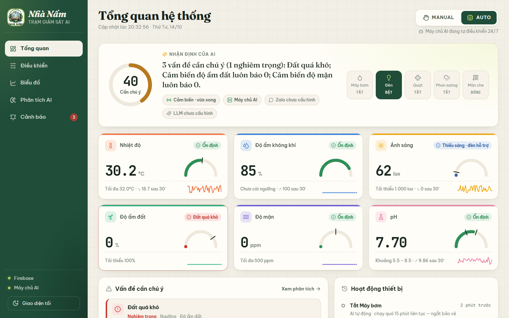
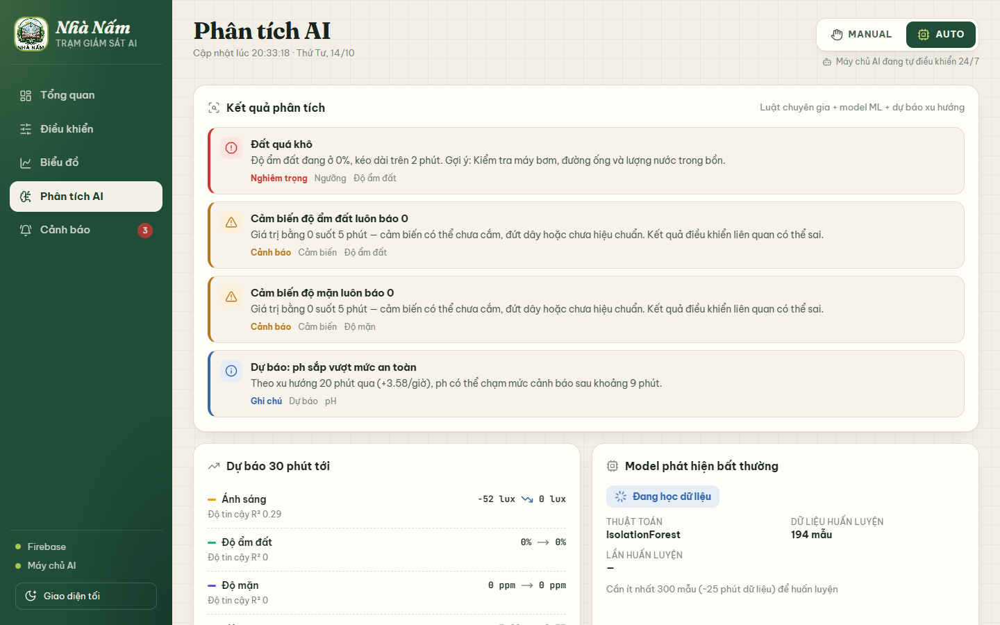
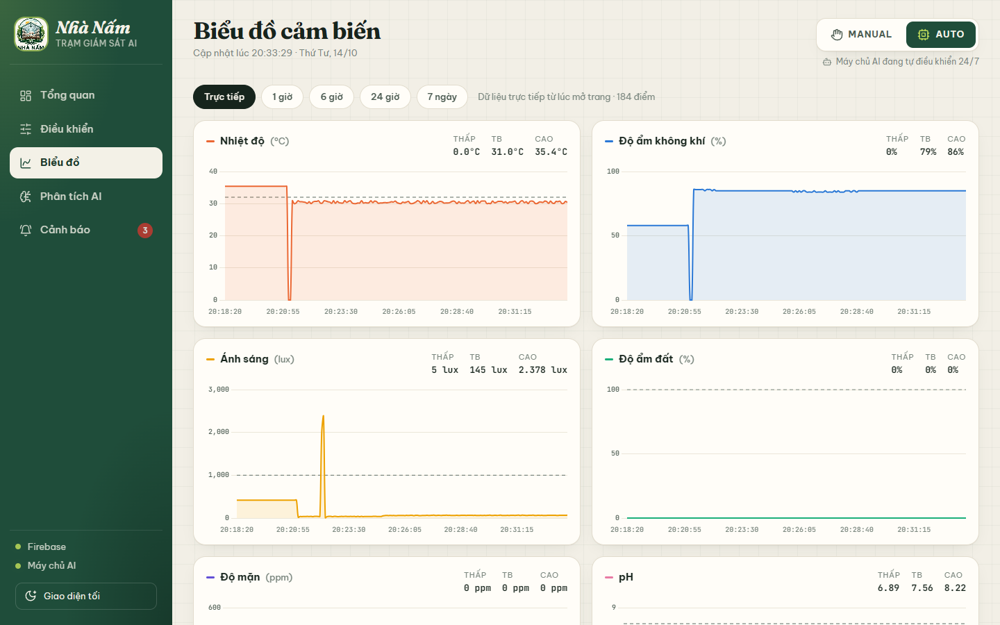
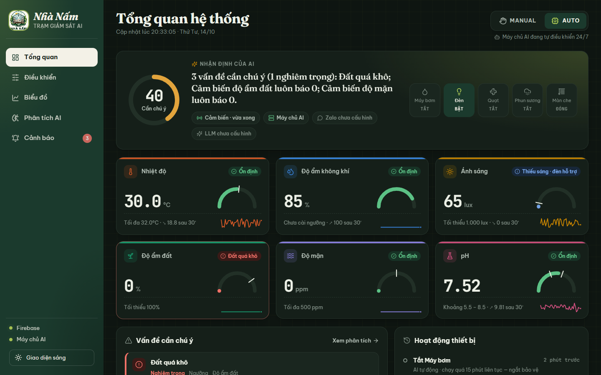

# Nhà Nấm · Trạm giám sát AI

Web giám sát cảm biến nhà nấm/nhà kính (ESP32 + Firebase) kèm **Máy chủ AI** chạy nền: phân tích dữ liệu bằng luật chuyên gia + model ML, tự động bật/tắt thiết bị 24/7, gửi cảnh báo và nhận lệnh qua **Zalo Bot**, tích hợp **LLM** viết nhận định/báo cáo.



| Phân tích AI | Biểu đồ | Giao diện tối |
|---|---|---|
|  |  |  |

```
ESP32 ──► Firebase RTDB ◄──► Web (index.html)        ← xem & điều khiển
                 ▲
                 └──► Máy chủ AI (server/app.py)      ← phân tích, AUTO 24/7, Zalo, LLM
                          ├─ SQLite lịch sử (server/data/)
                          ├─ Zalo Bot  ◄─► điện thoại
                          └─ LLM (Claude / OpenAI / Gemini / Groq...)
```

## Chạy nhanh (Windows) — 1 file duy nhất

Nhấp đúp **`CHAY_NHA_NAM.bat`**. File này:
1. Lần đầu tự cài Python, thư viện và Cloudflare Tunnel (`cloudflared`), hỏi key Gemini / token Zalo (Enter để bỏ qua). Các lần sau bỏ qua bước cài nên mở nhanh.
2. Chạy **web + máy chủ AI + link từ xa** trong một cửa sổ. Khoảng 30 giây sau cửa sổ in link `https://….trycloudflare.com` và tự mở trình duyệt; link cũng được gửi về Zalo, ghi vào `LINK_WEB.txt` và hiện ở tab **Cảnh báo**. Không cần đăng nhập.
3. **Đóng cửa sổ là tắt hết** — không tự chạy khi mở máy, không chạy ngầm gửi tin Zalo.

Link đổi mỗi lần chạy lại. Trong máy: http://localhost:5000 · điện thoại cùng WiFi: `http://<IP máy tính>:5000`.

Còn bản cũ chạy ngầm / tự chạy khi mở máy (bộ cài trước đây): chạy **`DUNG_NHA_NAM.bat`** một lần (CHAY_NHA_NAM.bat cũng tự gỡ).

Cấu hình nằm ở `server/.env` (tạo từ `server/.env.example`): `ZALO_BOT_TOKEN`, `ZALO_CHAT_IDS`, `LLM_*`… Chi tiết đường hầm và link cố định: [docs/CLOUDFLARE_TUNNEL.md](docs/CLOUDFLARE_TUNNEL.md).

> Không biết chat id? Nhắn `chatid` cho bot sau khi chạy server — bot trả lời ID; tab **Cảnh báo** trên web cũng liệt kê các chat đã nhắn.
>
> Muốn chạy thử an toàn (không ghi Firebase, không gửi Zalo): đặt `DRY_RUN=true`.

Web vẫn dùng được khi **không** chạy máy chủ AI (mở thẳng `index.html`): xem số liệu, điều khiển, biểu đồ trực tiếp.

## Firmware ESP32 (`aduno.ino`)
ESP32 đọc cảm biến (DHT11, BH1750, độ ẩm đất, độ mặn TDS, pH), hiển thị LCD, phát âm thanh DFPlayer, ghi Google Sheet và đồng bộ Firebase qua REST:

| Hướng | Nội dung | Chu kỳ |
|---|---|---|
| ESP → Firebase | `t h ANHSANG GT_AMDAT GT_DOMAN GT_PH`, nhịp tim `ESP_TS` (+ trạng thái thiết bị khi AUTO) | 0.7 s |
| Firebase → ESP | `SET_*`, `MODE`, lệnh thiết bị (dùng khi MANUAL) | 1 s |

**Chế độ AUTO do ESP32 tự điều khiển**: đèn bật khi ánh sáng < `SET_AS`; màn che MỞ khi ánh sáng ≤ `SET_AS`, ĐÓNG khi sáng hơn; quạt bật khi nhiệt độ > `SET_T`; phun sương bật khi độ ẩm < `SET_H`; bơm bật khi độ ẩm đất < `SET_AMDAT`. Bơm bị ngắt khi độ mặn > `SET_DOMAN`; bơm và phun sương bị ngắt khi pH ngoài `SET_PHLOW`–`SET_PHHIGH`.
**MANUAL**: web/Zalo ghi lệnh lên Firebase, ESP32 thực thi trong ~1 giây.

Nguồn điện / WiFi chập chờn, ESP32 hay khởi động lại: xem [docs/PHAN_CUNG_ON_DINH.md](docs/PHAN_CUNG_ON_DINH.md) (web tab Cảnh báo có thẻ **Nguồn & WiFi ESP32**).

Nạp firmware: sao chép `secrets.example.h` thành `secrets.h` (cùng thư mục với `aduno.ino`), điền WiFi, link Google Apps Script và Firebase secret (nếu đã khóa rules). `secrets.h` không được đưa lên Git.

## Chức năng

| Phần | Nội dung |
|---|---|
| **Tổng quan** | Trạng thái kết nối ESP32 (đã kết nối / chậm / mất kết nối + từ bao giờ), **2 chỉ số riêng: Môi trường nhà nấm và Nước cấp**, nhận định AI, **thời tiết ngoài trời + Random Forest dự đoán 1–3 giờ tới (tham khảo)**, 6 thẻ cảm biến (đồng hồ + ngưỡng), trạng thái thiết bị, vấn đề & lịch sử bật/tắt |
| **Điều khiển** | Công tắc thiết bị, màn che, cài ngưỡng (có đơn vị & giải thích) |
| **Biểu đồ** | Trực tiếp / 1h / 6h / 24h / 7 ngày, đường ngưỡng, thấp–TB–cao |
| **Phân tích AI** | Danh sách vấn đề, thời tiết ngoài trời 3 giờ tới, mô hình Random Forest (sai số, yếu tố ảnh hưởng), báo cáo AI, chat hỏi đáp |
| **Cảnh báo** | Lịch sử cảnh báo (lọc mức độ), trạng thái Zalo, gửi tin thử, tạm tắt thông báo |

### Hai chỉ số (server/indices.py)
| Chỉ số | Dữ liệu đầu vào | Ý nghĩa | Hành động |
|---|---|---|---|
| 🌿 **Môi trường nhà nấm** (0–100: Tốt/Khá/Cần chú ý/Nguy hiểm) | Nhiệt độ, độ ẩm không khí, ánh sáng, độ ẩm giá thể | Vi khí hậu có phù hợp với nấm không | Phun sương, quạt, màn che, đèn |
| 💧 **Chất lượng nước cấp** (Đạt/Cần theo dõi/Không đạt) | pH, độ mặn/TDS | Nước có an toàn để tưới, phun sương không | Khóa bơm; kiểm tra nguồn nước, lọc hoặc thay nước |

pH và độ mặn **không trung bình hóa** với nhiệt độ hay ánh sáng: môi trường tốt mà nước không đạt thì kết luận chung là “Nước không đạt”, kèm cảnh báo riêng *“Nước cấp không đạt — … đang bị khóa”* theo đúng firmware (pH ngoài khoảng → khóa bơm và phun sương; mặn vượt ngưỡng → khóa bơm).

### Phân tích (server/analyzer.py)
- **Luật chuyên gia**: vượt ngưỡng kéo dài > 2 phút (tránh báo nhầm do nhiễu), cảm biến lỗi/phi lý, nhiễu (giật số), báo 0 liên tục, đứng yên (ESP32 mất kết nối).
- **Thiết bị**: bơm chạy 8 phút mà đất không ẩm lên, quạt 15 phút không hạ nhiệt, phun sương không tăng ẩm, đèn bật không sáng hơn, màn che nhận cả MỞ & ĐÓNG, bật/tắt liên tục (≥ 6 lần/10 phút), bơm/phun sương chạy quá lâu.

### Random Forest + thời tiết ngoài trời (server/rf_model.py, server/weather.py) — CHỈ THAM KHẢO
**Thiết bị luôn bật/tắt theo ngưỡng** cài trên web (firmware ESP32); phần này không điều khiển gì.
- **Thời tiết**: lấy từ [Open-Meteo](https://open-meteo.com) (miễn phí, không cần key) 15 phút/lần — nhiệt độ, độ ẩm, mây, bức xạ mặt trời, mưa, gió (31 ngày qua + 2 ngày tới). Vị trí theo `WEATHER_LAT`/`WEATHER_LON`, để trống thì đoán theo IP mạng.
- **Một mô hình Random Forest** (200 cây, scikit-learn) học từ dữ liệu theo giờ: chỉ số trong nhà + thiết bị đang chạy + thời tiết giờ này và giờ tới + giờ trong ngày → **mức thay đổi trong 1 giờ** của nhiệt độ, độ ẩm không khí, độ ẩm đất, **pH, độ mặn**. Dự đoán = số đo hiện tại + mức thay đổi, lặp 3 bước cho **1–3 giờ tới**; mỗi bước bị giới hạn trong mức thay đổi thực tế đã thấy (không nhảy 100% → 48%). Giờ có cảm biến lỗi (độ ẩm đất 0%, nhảy số khi cắm lại) bị loại khi học. Học lại mỗi giờ; cần ≥ 24 giờ dữ liệu (máy chủ chạy ít nhất ~1 ngày). Web hiện sai số trung bình và các yếu tố ảnh hưởng nhiều nhất.
- Kết quả hiện ở trang Tổng quan, tab Phân tích AI, tin Zalo định kỳ và lệnh `/phantich` — kèm gợi ý (vd *“Độ ẩm không khí có thể xuống ~62% trong 2 giờ tới — phun sương sẽ bật theo ngưỡng”*).

### Máy chủ AI và chế độ AUTO
Mặc định máy chủ AI **chỉ giám sát**: **mọi lần** thiết bị bật/tắt (ESP32 tự động hoặc bấm trên web) đều báo Zalo kèm giờ và lý do (vd “14:05:12 BẬT máy bơm — ESP32 tự động: độ ẩm đất 32% < ngưỡng 40%”), các lần trong `DEVICE_BATCH_SEC` giây gom thành 1 tin, và cảnh báo khi thiết bị bật/tắt liên tục hoặc bơm chạy quá lâu.

Nếu dùng firmware **không** tự điều khiển, đặt `AUTO_CONTROL_ENABLED=true` để máy chủ điều khiển thay (cùng luật với firmware, thêm vùng trễ, ngắt bảo vệ bơm/phun sương sau `PUMP_MAX_ON_MIN`/`MIST_MAX_ON_MIN` phút, tắt thiết bị khi cảm biến lỗi). Không bật cùng lúc với firmware tự điều khiển — hai bên sẽ ghi đè nhau.

### Zalo
Tự gửi: **tình trạng định kỳ mỗi `PERIODIC_REPORT_SEC` giây** (mặc định 1 giờ, tối thiểu 10 phút) kèm thời tiết ngoài trời và kết quả Random Forest (tham khảo), cảnh báo mới (kèm “Nhận định AI” nếu có LLM), nhắc lại sau `ALERT_REPEAT_MIN` phút nếu chưa xử lý, báo khi đã ổn định, mọi lần bật/tắt thiết bị, **mạch ESP32 tắt / mất kết nối (sau 60 giây) và khi hoạt động lại** (kèm lý do khởi động: mất điện, sụt áp…, ưu tiên cao), mất kết nối Firebase, báo cáo buổi sáng lúc `DAILY_REPORT_HOUR`.

**Hạn mức tin:** Zalo khóa bot gửi quá nhiều (“vượt quá hạn mức gửi tin nhắn”), nên máy chủ tự giới hạn `ZALO_MAX_PER_HOUR` (30) / `ZALO_MAX_PER_DAY` (300) tin; báo cáo định kỳ dừng trước để dành chỗ cho cảnh báo; Zalo báo vượt hạn mức thì ngừng gửi `ZALO_PAUSE_MIN` phút. **Gửi lỗi do mạng** thì tự thử lại 3 lần, vẫn lỗi thì giữ tin và gửi bù khi có mạng (ghi “gửi chậm N phút”). Tab Cảnh báo hiện số tin đã dùng.

Lệnh (chỉ chat có trong `ZALO_CHAT_IDS`): `/trangthai` `/phantich` `/thoitiet` `/baocao` `/canhbao` `/auto` `/manual` `/bat quat` `/tat bom` `/tat het` `/mo man` `/dong man` `/im 60` `/batthongbao` `chatid` — hoặc hỏi tự do, AI trả lời dựa trên số liệu.

### LLM (server/llm.py)
| Nhà cung cấp | Cấu hình `.env` |
|---|---|
| Claude | `LLM_PROVIDER=anthropic`, `LLM_API_KEY=sk-ant-...` (mặc định `claude-opus-5-5`) |
| OpenAI | `LLM_PROVIDER=openai`, `LLM_API_KEY=sk-...` (mặc định `gpt-4o-mini`) |
| Gemini | `LLM_PROVIDER=openai`, `LLM_BASE_URL=https://generativelanguage.googleapis.com/v1beta/openai`, `LLM_MODEL=gemini-3.8-flash` |
| Groq / DeepSeek / OpenRouter / Ollama | `LLM_PROVIDER=openai` + `LLM_BASE_URL` + `LLM_MODEL` tương ứng |

Không có key → hệ thống dùng tin nhắn mẫu, mọi chức năng khác vẫn chạy.

## Cấu trúc
```
aduno.ino                       Firmware ESP32
index.html, style.css, app.js   Web (Firebase realtime, điều khiển)
js/                             Module web: cảm biến, biểu đồ, kết nối máy chủ AI
server/app.py                   Flask: phục vụ web + API
server/engine.py                Vòng lặp chính: đọc → lưu → điều khiển → phân tích → cảnh báo
server/analyzer.py              Luật chuyên gia (ngưỡng, cảm biến, thiết bị, nguồn ESP32)
server/rf_model.py, weather.py  Random Forest + thời tiết Open-Meteo (tham khảo)
server/controller.py            Tự động điều khiển an toàn
server/commands.py, zalo_bot.py Zalo Bot: gửi tin & nhận lệnh
server/llm.py                   Kết nối LLM
```

## Lưu ý
- **Bảo mật Firebase**: database mặc định cho ghi tự do — xem [docs/BAO_MAT_FIREBASE.md](docs/BAO_MAT_FIREBASE.md) để khóa lại.
- `server/.env` chứa token — không commit (đã có `.gitignore`).
- API của máy chủ AI không có đăng nhập: chỉ mở trong mạng nội bộ; muốn đưa ra Internet cần thêm xác thực.
